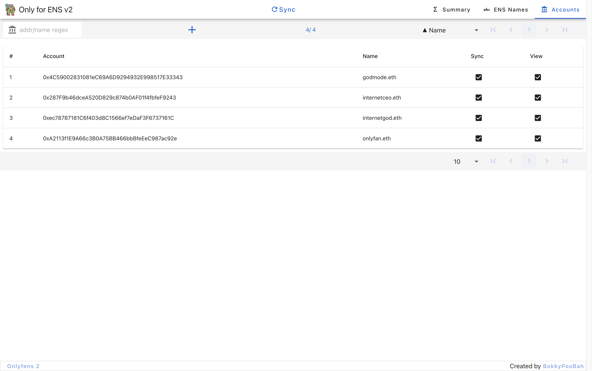
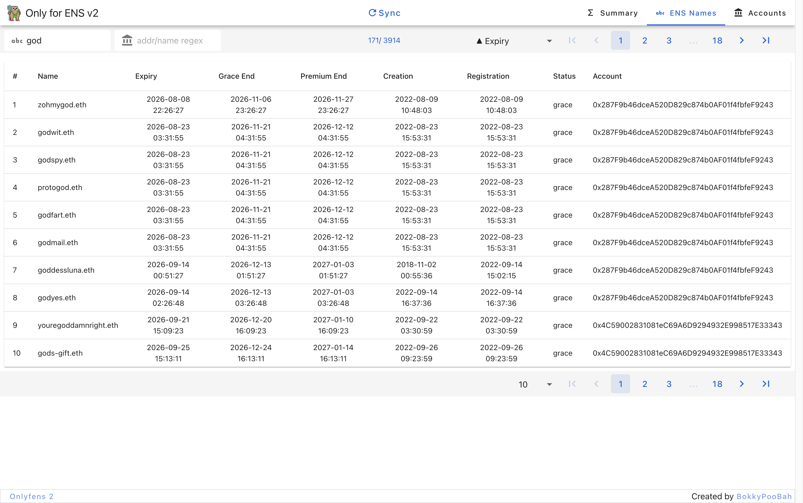
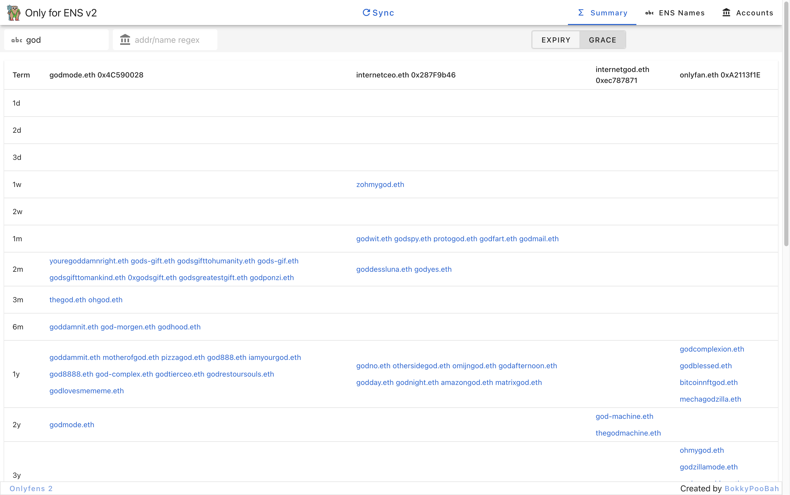

# Only for ENS v2

https://bokkypoobah.github.io/onlyfens2/

This is a rewrite of Only For ENS https://bokkypoobah.github.io/onlyfens/ as the MetaMask / Infura web3 connection `getLog(...)` call is now limited to 10,000 blocks. This rewrite uses the JSON API from https://grails.app/ with X account https://x.com/grailsmarket.

 

## Screenshots

### Accounts

<kbd></kbd>

Set up your Ethereum accounts in the Accounts tab

### View Names

<kbd></kbd>

Click Sync and view your names in the ENS Names tab

### Summary

<kbd></kbd>

and

<kbd></kbd>

View your names by expiry sorted into a term bucket.

 

 

Enjoy!

onlyfens.eth, Only for ENS v2 © Bok Consulting Pty Ltd 2026, MIT license
